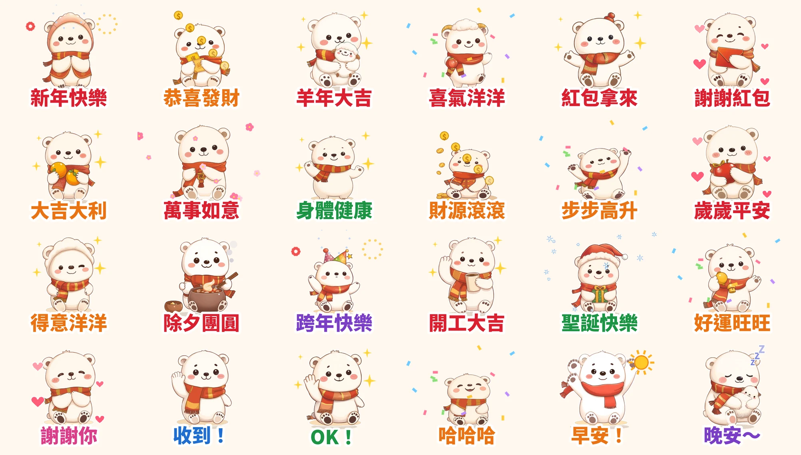

# Polar Bear Xiuxiu: Happy New Year — 24 Animated LINE Stickers

Our chubby polar bear character **Xiuxiu (北極熊秀秀)** is back in a festive 24-sticker animated LINE pack for Christmas, New Year's Eve, and the 2027 Lunar New Year (Year of the Sheep / 羊年).

> **Get the pack on LINE Store:** [Massor's LINE Sticker Shop](https://line.me/S/shop/sticker/author/6564520?utm_source=slashmantools&utm_medium=blog&utm_campaign=xiuxiu-new-year&utm_content=author-6564520) (NT$60 / 100 Coins, 24 animated stickers)

## What is inside the 24-sticker pack

- **18 Festive & Year of the Sheep Greetings (01–18):** Happy New Year (新年快樂), Prosperity & Wealth (恭喜發財), Year of the Sheep Luck (羊年大吉), Joyful Lantern Dance (喜氣洋洋), Red Envelope Please (紅包拿來), Thank You for the Red Envelope (謝謝紅包), Great Luck Tangerines (大吉大利), All Wishes Come True (萬事如意), Good Health (身體健康), Rolling Coins (財源滾滾), Rising Higher (步步高升), Peace Every Year (歲歲平安), Proud Sheep Hood (得意洋洋), Reunion Hotpot (除夕團圓), Happy Countdown (跨年快樂), Back to Work Luck (開工大吉), Merry Christmas (聖誕快樂), and Lucky Bell (好運旺旺).
- **6 Everyday Reactions (19–24):** Thank You, Roger That, OK!, Hahaha, Good Morning, and Good Night — so the pack stays useful all year long.

## How we built it locally

1. **Character Consistency with FLUX + LoRA:** All 24 poses were generated locally on an NVIDIA GB10 using `flux1-schnell-fp8` + `flux-whimsical-storybook-lora` with a locked seed and consistent character prompt.
2. **Automated APNG Pipeline:** Each character is cut out cleanly, given a crisp white sticker rim for dark mode readability, animated into a 3-second looping APNG (≤320×270, ≤300 KB), and paired with bold Traditional Chinese typography.
3. **Interactive Preview:** View all 24 looping animated clips on our [Chinese launch post](https://ckw19810413.github.io/blog/2026-11-24-line-animated-sticker-polar-bear-xiuxiu-new-year/).

[Browse all Massor LINE Stickers →](https://line.me/S/shop/sticker/author/6564520?utm_source=slashmantools&utm_medium=blog&utm_campaign=xiuxiu-new-year&utm_content=author-6564520)
