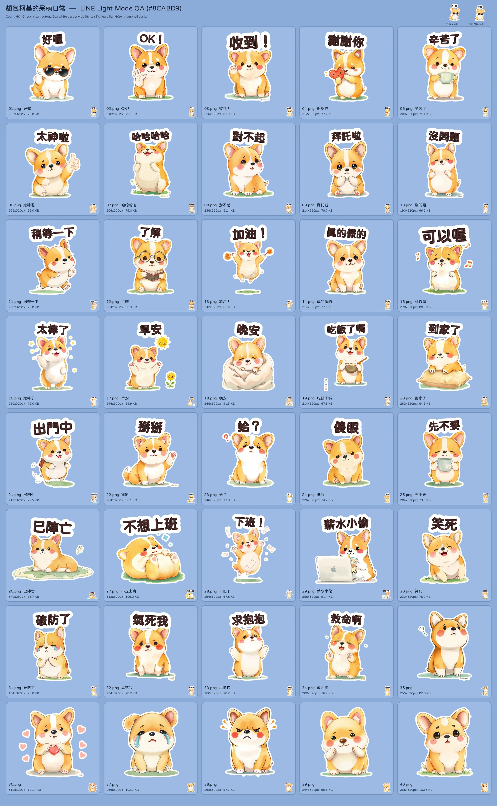

# Bread Loaf Corgi Daily — 40 Storybook LINE Stickers

Meet **Bread Loaf Corgi (麵包柯基)** — a chubby, golden-tan and white corgi puppy shaped like a soft bread loaf with big round ears, rosy cheeks, and stubby paws, now packed into **40 healing chibi LINE stickers** (34 Traditional Chinese daily phrases + 6 universal text-free reactions).

> **Browse on LINE Store:** [Massor's LINE Sticker Shop](https://line.me/S/shop/sticker/author/6564520?utm_source=slashmantools&utm_medium=blog&utm_campaign=corgi-bread-daily&utm_content=author-6564520)  
> **Pack ID:** `49481794` — Submitted for review on 2026-11-26 with auto-release enabled ([Direct Store Link](https://store.line.me/stickershop/product/49481794/en?utm_source=slashmantools&utm_medium=blog&utm_campaign=corgi-bread-daily&utm_content=sticker-49481794)).

## Highlights of This 40-Sticker Pack

- **Healing Picture-Book Aesthetic:** Soft colored-pencil and watercolor-wash textures with warm dark brown outlines and 2-head-tall bread-loaf proportions.
- **Daily Greetings + Office Relatability + Text-Free Reactions:** Covers everyday essentials, relatable work/life humor, and 6 captionless expressions that work naturally across **Taiwan, Hong Kong, Japan**, and international chats.
- **Dark-Mode Ready:** Every sticker is cleanly cut out with a crisp 5px white die-cut border and validated against all LINE Creators Market specs (40 RGBA PNGs ≤ 370×320 even dimensions, `main.png` 240×240, `tab.png` 96×74).

## Local AI + Automated Packaging Workflow

1. **Consistent Character Generation:** Generated locally with ComfyUI + FLUX (`flux1-schnell-fp8`) using `flux-whimsical-storybook-lora` + `watercolor_strokes` LoRA and a deterministic seed sequence.
2. **Automated Post-Processing & QA:** Chroma-key cutout, 5px white outline, LINE-compliant resizing, and light/dark contact sheet inspection.
3. **Chinese & Japanese Launch Post:** See the full Traditional Chinese & Japanese announcement on [ckw19810413.github.io](https://ckw19810413.github.io/blog/2026-11-26-line-sticker-corgi-bread-daily/).

[Browse all Massor LINE Stickers →](https://line.me/S/shop/sticker/author/6564520?utm_source=slashmantools&utm_medium=blog&utm_campaign=corgi-bread-daily&utm_content=author-6564520)
