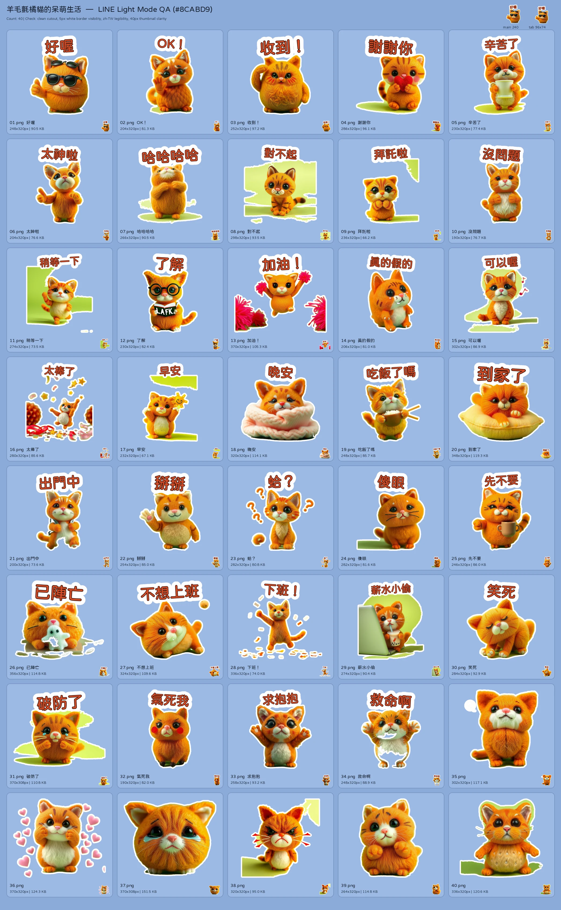

# Wool Felt Tabby Cat Daily — 40 Handmade-Style 3D LINE Stickers

Meet **Wool Felt Tabby Cat (羊毛氈橘貓)** — an adorable, chubby round orange tabby cat crafted in handmade needle-felted wool miniature style, now packed into **40 expressive LINE stickers** (34 Traditional Chinese everyday & workplace phrases + 6 universal text-free reactions).

> **Browse on LINE Store:** [Massor's LINE Sticker Shop](https://line.me/S/shop/sticker/author/6564520?utm_source=slashmantools&utm_medium=blog&utm_campaign=felt-tabby-cat&utm_content=author-6564520)  
> **Pack ID:** `49526726` — Submitted for review on 2026-11-27 with auto-release enabled ([Direct Store Link](https://store.line.me/stickershop/product/49526726/en?utm_source=slashmantools&utm_medium=blog&utm_campaign=felt-tabby-cat&utm_content=sticker-49526726)).

## Highlights of This 40-Sticker Pack

- **Tactile Needle-Felted Wool Aesthetic:** Visible fuzzy wool fibers, tiny glossy black bead eyes, clumsy dumpling proportions, and warm studio macro lighting that stands out in any chat feed.
- **Daily Greetings + Workplace Humor + Text-Free Reactions:** 16 universal replies (got it, OK, thanks, well done…), 6 everyday greetings (good morning, good night, eaten yet?), 12 relatable daily moods (don't wanna go to work, salary thief, need a hug, help!), plus 6 captionless reactions that work naturally across **Taiwan, Hong Kong, Japan**, and international chats.
- **Dark-Mode Ready:** Every sticker is cleanly cut out with a crisp 5px white die-cut border and validated against all LINE Creators Market specs (40 RGBA PNGs ≤ 370×320 even dimensions, `main.png` 240×240, `tab.png` 96×74).

## Local AI + Automated Packaging Workflow

1. **Consistent Character Generation:** Generated locally with ComfyUI + FLUX (`flux1-schnell-fp8`) using `realism.safetensors` LoRA and a deterministic seed sequence (`2026112702`) for a consistent needle-felted tabby cat across all 40 stickers.
2. **Automated Post-Processing & QA:** Chroma-key cutout, 5px white outline, LINE-compliant resizing, and light/dark contact sheet inspection.
3. **Chinese & Japanese Launch Post:** See the full Traditional Chinese & Japanese announcement on [ckw19810413.github.io](https://ckw19810413.github.io/blog/2026-11-27-line-sticker-felt-tabby-cat/).

[Browse all Massor LINE Stickers →](https://line.me/S/shop/sticker/author/6564520?utm_source=slashmantools&utm_medium=blog&utm_campaign=felt-tabby-cat&utm_content=author-6564520)
