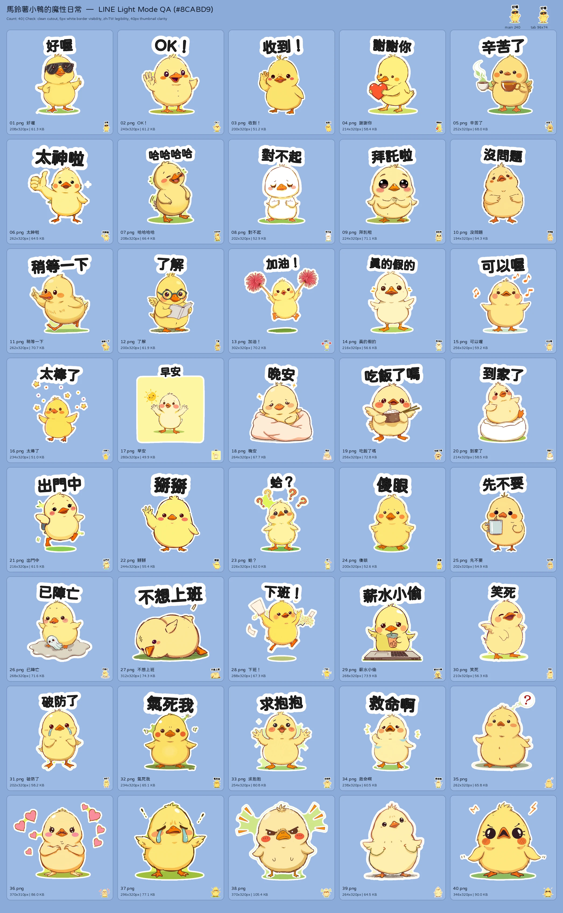

# Potato Duck Quirky Daily — 40 Expressive LINE Stickers

Meet **Potato Duck (馬鈴薯小鴨)** — a chubby, potato-shaped pale yellow duckling with tiny stubby wings, a funny orange bill, and deadpan dot eyes, now packed into **40 text-free expressive LINE stickers**.

> **Browse on LINE Store:** [Massor's LINE Sticker Shop](https://line.me/S/shop/sticker/author/6564520?utm_source=slashmantools&utm_medium=blog&utm_campaign=potato-duck-quirky-daily&utm_content=author-6564520)  
> **Pack ID:** `49451304` — Submitted for review on 2026-11-25 with auto-release enabled ([Direct Store Link](https://store.line.me/stickershop/product/49451304/en?utm_source=slashmantools&utm_medium=blog&utm_campaign=potato-duck-quirky-daily&utm_content=sticker-49451304)).

## Why Text-Free Expressive Stickers?

- **Zero Language Barrier:** Designed to work effortlessly across **Taiwan, Hong Kong, Japan**, and international group chats without needing translated captions.
- **Ugly-Cute Hand-Drawn Vibe:** 40 distinct comedic, exaggerated reactions — from deadpan side-eye and office burnout meltdowns to dramatic cheering and shocked panic.
- **Dark-Mode Ready:** Every sticker is cleanly cut out with a crisp 5px white die-cut border and validated against all LINE Creators Market specs (40 RGBA PNGs ≤ 370×320 even dimensions, `main.png` 240×240, `tab.png` 96×74).

## Local AI + Automated Packaging Workflow

1. **Consistent Character Generation:** Generated locally with ComfyUI + FLUX (`flux1-schnell-fp8`) using a locked character prompt and deterministic seed sequence.
2. **Automated Post-Processing & QA:** Chroma-key cutout, white outline, LINE-compliant resizing, and light/dark contact sheet inspection.
3. **Chinese Launch Post & Preview:** See the Traditional Chinese & Japanese announcement on [ckw19810413.github.io](https://ckw19810413.github.io/blog/2026-11-25-line-sticker-potato-duck-quirky-daily/).

[Browse all Massor LINE Stickers →](https://line.me/S/shop/sticker/author/6564520?utm_source=slashmantools&utm_medium=blog&utm_campaign=potato-duck-quirky-daily&utm_content=author-6564520)
