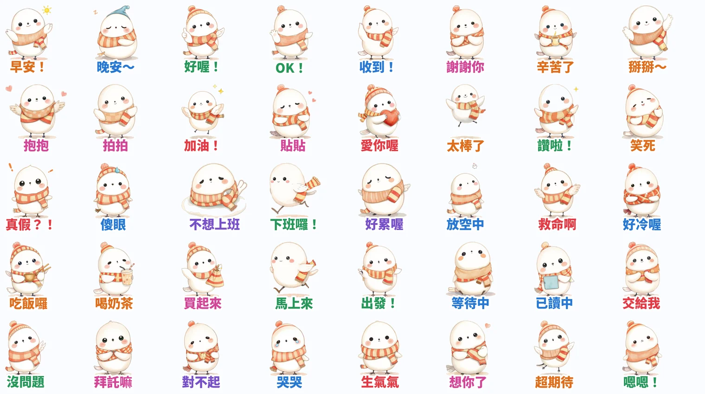
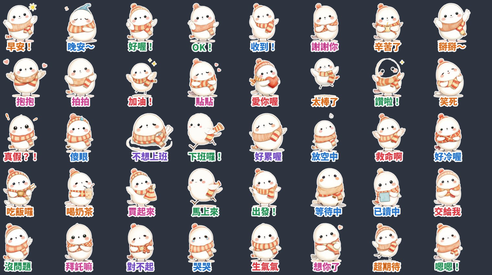

# Snowball Mochi: Shimaenaga Daily — 40 Cozy LINE Stickers

Inspired by Japan's beloved winter "Snow Fairy" (**Shimaenaga / シマエナガ / 銀喉長尾山雀**), **Snowball Mochi (雪球糰子)** brings 40 expressive, ultra-round daily chat stickers to LINE at just **70 LINE Coins (NT$42)**.

> **Browse on LINE Store:** [Massor's LINE Sticker Shop](https://line.me/S/shop/sticker/author/6564520?utm_source=slashmantools&utm_medium=blog&utm_campaign=snowball-mochi&utm_content=author-6564520) (40 static stickers, 70 Coins / NT$42)

## Dark Mode Ready

Every sticker features a crisp hand-drawn white outline and bold high-contrast typography so it pops cleanly in both Light and Dark chat themes:

## What's Inside (40 Expressions)

- **Everyday Essentials:** Good Morning, Good Night, Sure!, OK!, Roger That, Thank You, Good Work, Bye-Bye, Yep!
- **Cozy Winter & Warm Care:** So Cold, Hugs, Pat Pat, You Got This!, Snuggle, Love You, Miss You, Please, So Excited
- **Playful Work & Relatable Humor:** Don't Wanna Work, Clocking Out!, So Tired, Zoning Out, Read/Seen, LOL, Really?!, Speechless, Help!
- **Food & Plans:** Time to Eat, Bubble Tea, Buy It!, On My Way, Let's Go!, Waiting, Leave It to Me, No Problem, Sorry, Crying, Grumpy, Awesome!, Nice!

## Local AI Generation Pipeline

1. **Trend Research:** Analyzed live Taiwan and Japan LINE sticker top charts where winter Shimaenaga birds, mochi-round characters, and bold relatable reactions are surging.
2. **Consistent FLUX + LoRA Art:** Generated all 40 poses locally using `flux1-schnell-fp8` + `flux-whimsical-storybook-lora` with a locked seed.
3. **Automated Packaging:** Clean alpha cutout, white sticker rim, even-dimension LINE spec validation (≤370×320, <1 MB), and automated LINE Creators Market submission.

- Read the Traditional Chinese / Cantonese / Japanese showcase on [ckw19810413.github.io](https://ckw19810413.github.io/blog/2026-11-25-line-sticker-snowball-mochi-shimaenaga/)
- [Visit Massor's LINE Sticker Shop →](https://line.me/S/shop/sticker/author/6564520?utm_source=slashmantools&utm_medium=blog&utm_campaign=snowball-mochi&utm_content=author-6564520)
